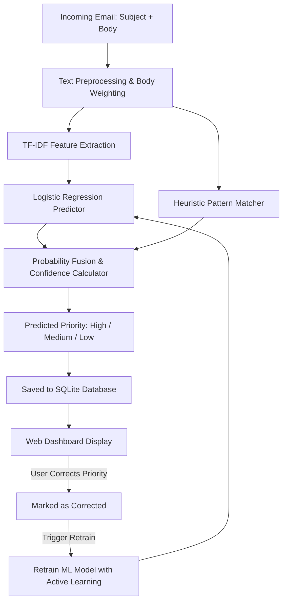

# 📬 AI-Powered Email Priority Classifier

[](https://www.python.org/)
[](https://www.djangoproject.com/)
[](https://scikit-learn.org/)
[](LICENSE)

An intelligent, full-stack email classification and triaging system built with **Django** and **Scikit-Learn**. It automatically classifies emails into **High**, **Medium**, or **Low** priority using a hybrid Natural Language Processing (NLP) pipeline that combines **TF-IDF vectorization**, **Logistic Regression**, and **heuristic rule boosting**, complete with an interactive **Human-in-the-Loop (Active Learning)** retraining loop.

---

## 🌟 Key Features

- **Hybrid NLP Classification**:
  - **TF-IDF Vectorizer**: Sublinear term-frequency scaling and unigram/bigram extraction (`ngram_range=(1, 2)`).
  - **Balanced Logistic Regression**: Trained on diverse seed emails with automatic class balancing.
  - **Heuristic Pattern Boosters**: Context-aware regex rules to detect critical outages, tight deadlines, routine action items, and spam/promotional signals.
- **Confidence Scoring**: Computes calibrated confidence percentages for each classification decision.
- **Active Learning & Retraining**:
  - One-click manual override (`Mark High`, `Mark Medium`, `Mark Low`) for any misclassified email.
  - Built-in **Retrain** engine that dynamically fits the ML model with newly labeled user data without server restarts.
- **Interactive Web Dashboard**:
  - Fast, responsive user interface with color-coded priority badges and counter tabs.
  - Filter emails by priority level or view all items in chronological order.
  - Email deletion and inline priority management.
- **Tested & Reliable**: Includes unit test suite covering end-to-end inference across priority classes.

---

## 📊 Priority Criteria

| Priority | Criteria & Characteristics | Typical Examples |
| :--- | :--- | :--- |
| <span style="color:#d92d20; font-weight:bold;">High</span> | Critical emergencies, production outages, security alerts, urgent deadlines, and immediate action items. | *"Server down in production"*, *"Payment failure - account suspended"*, *"Deadline tonight 11:59 PM"* |
| <span style="color:#b54708; font-weight:bold;">Medium</span> | Routine work, scheduled meetings, review requests, general announcements, and upcoming tasks. | *"Weekly meeting agenda"*, *"Draft proposal feedback by Friday"*, *"Pull request awaiting review"* |
| <span style="color:#067647; font-weight:bold;">Low</span> | Newsletters, marketing promotions, discounts, event flyers, automated digests, and spam. | *"Weekend flash sale: 50% off"*, *"Weekly newsletter digest"*, *"Claim your exclusive coupon"* |

---

## 🏗️ Architecture & Workflow



---

## 🛠️ Tech Stack

- **Backend**: Python, Django 5+
- **Machine Learning**: Scikit-Learn (TF-IDF, Logistic Regression), Joblib
- **Database**: SQLite (default, easily swappable with PostgreSQL or MySQL)
- **Frontend**: Clean Vanilla HTML5, CSS3 with responsive grid and custom design tokens

---

## 📁 Project Structure

```text
Email-Priority-Classifier/
├── classifier/
│   ├── management/
│   │   └── commands/
│   │       └── train.py           # CLI command to train the ML model
│   ├── migrations/                # Database migrations
│   │   └── 0001_initial.py
│   ├── templates/
│   │   └── classifier/
│   │       └── index.html         # Responsive web UI & dashboard
│   ├── admin.py                   # Django admin registrations
│   ├── apps.py                    # App configuration
│   ├── data.py                    # Curated seed training dataset
│   ├── forms.py                   # Email submission form
│   ├── ml.py                      # NLP pipeline, model training & inference logic
│   ├── models.py                  # Email data model
│   ├── tests.py                   # Unit tests
│   ├── urls.py                    # URL routing for classifier app
│   └── views.py                   # Controllers: classify, filter, relabel, retrain
├── config/
│   ├── asgi.py                    # ASGI entry point
│   ├── settings.py                # Django project settings
│   ├── urls.py                    # Root URL configuration
│   └── wsgi.py                    # WSGI entry point
├── .gitignore                     # Git ignore rules for Python & Django
├── manage.py                      # Django CLI utility
├── priority_model.joblib          # Serialized trained model
├── README.md                      # Project documentation
└── requirements.txt               # Python package dependencies
```

---

## 🚀 Quick Start Guide

### 1. Prerequisites
Ensure you have **Python 3.10+** and **Git** installed on your system.

### 2. Clone the Repository
```bash
git clone https://github.com/Mathan-1002/Email-Priority-Classifier.git
cd Email-Priority-Classifier
```

### 3. Create and Activate a Virtual Environment
- **Windows (Command Prompt / PowerShell)**:
  ```powershell
  python -m venv venv
  .\venv\Scripts\activate
  ```
- **macOS / Linux**:
  ```bash
  python3 -m venv venv
  source venv/bin/activate
  ```

### 4. Install Dependencies
```bash
pip install -r requirements.txt
```

### 5. Apply Database Migrations
```bash
python manage.py migrate
```

### 6. Train the Initial ML Model
Train the model on the seed dataset:
```bash
python manage.py train
```
*(Note: If omitted, the application will automatically train and persist the model on the first prediction).*

### 7. Run the Development Server
```bash
python manage.py runserver
```

Open your browser and navigate to:
```text
http://127.0.0.1:8000/
```

---

## 🧪 Running Tests

To verify that model inference and priority classification are working correctly:

```bash
python manage.py test
```

Expected output:
```text
Ran 3 tests in 0.24s
OK
```

---

## 💡 How It Works

1. **Email Submission**: Enter the sender (optional), subject line, and body in the classification form.
2. **Feature Extraction & Inference**: The text is preprocessed, converted to TF-IDF vectors, and evaluated against the machine learning model with heuristic boosting.
3. **Storage & Visualization**: The record is stored with its assigned priority, timestamp, and calculated confidence level.
4. **Active Learning Feedback Loop**: If an email is misclassified (e.g., marked Medium instead of High), click the corresponding **Mark High** button. Then click **Retrain** in the header to incorporate your correction into future predictions immediately.

---

## 📄 License

This project is licensed under the [MIT License](LICENSE).
